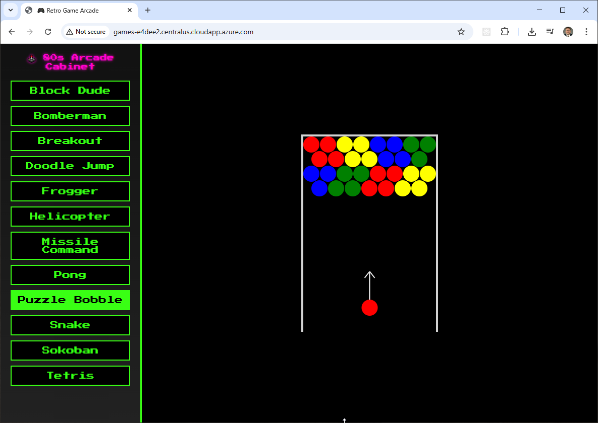
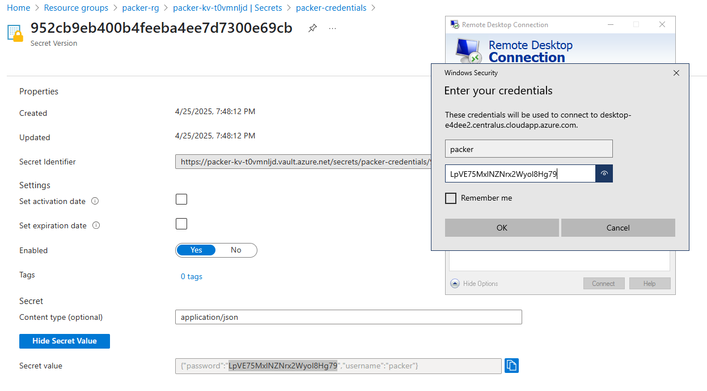
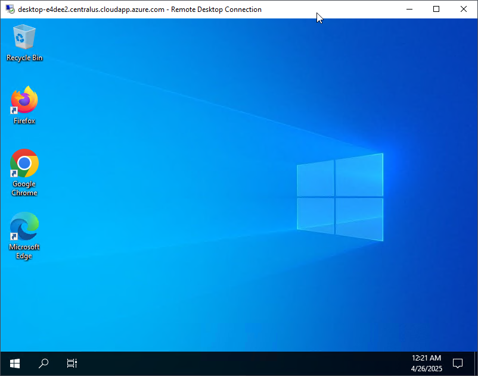

# Building VM Images with Packer on Azure

Two custom images built with **Packer** and deployed with **Terraform**: a
Linux **games** image, Ubuntu 24.04 with Apache serving a dozen retro HTML
games, and a Windows **desktop** image, Windows Server 2022 with the latest
updates, Chrome and Firefox. Both images carry a local `packer` account whose
password comes from Key Vault, and Terraform launches one VM from each, with
**Azure Bastion** as a portal-based way in.



| Piece | Where | Role |
|---|---|---|
| **games_image** | managed image in `packer-rg` | Ubuntu 24.04 + Apache + 12 HTML games, `packer` sudo user |
| **desktop_image** | managed image in `packer-rg` | Windows Server 2022 Datacenter + Windows updates, Chrome, Firefox, `packer` admin user; sysprepped |
| **games-vm** | `packer-subnet` | `Standard_B1s` from the newest games image; public IP `games-<id>.centralus.cloudapp.azure.com` |
| **desktop-vm** | `packer-subnet` | `Standard_B2s` from the newest desktop image; public IP `desktop-<id>.centralus.cloudapp.azure.com` |
| **Azure Bastion** | `AzureBastionSubnet` | SSH and RDP to both VMs from the Azure portal |
| **Key Vault** | `packer-rg` | `packer-kv-<suffix>`, secret `packer-credentials`: the `packer` user and a generated password |

## Architecture

<picture>
  <source media="(prefers-color-scheme: dark)" srcset="architecture-dark.svg">
  
</picture>

Regenerate with `python3 make_diagram.py`.

- **`01-infrastructure/`**: the resource group (`packer-rg`), the VNet
  (`packer-vnet`, 10.0.0.0/23) with `packer-subnet` and
  `AzureBastionSubnet`, their NSGs, the Bastion host, and the Key Vault with
  `packer-credentials`.
- **`02-packer/linux/`**: `linux_image.pkr.hcl`, the HTML games, and the
  install and user scripts.
- **`02-packer/windows/`**: `windows_image.pkr.hcl` and the PowerShell
  provisioners.
- **`03-deploy/`**: the two VMs, launched from the newest `games_image*` and
  `desktop_image*` images that `apply.sh` looks up.

## How the images are built

Packer creates and removes its own temporary resource group and VNet for each
build, and saves the result as a managed image in `packer-rg`.

**Linux** (`Standard_B1s` build VM):

1. Copies `html/` to the VM and installs Apache, which serves the games from
   `/var/www/html`.
2. Creates the `packer` user with the vault password and passwordless sudo.

**Windows** (`Standard_D2s_v3` build VM, WinRM over HTTPS):

1. Installs every available Windows update, then reboots.
2. Creates the `packer` user in Administrators and Remote Desktop Users,
   installs Chrome and Firefox, and cleans up the desktop.
3. Runs `Sysprep /oobe /generalize /shutdown`, so each VM boots clean.

## Network security

```
internet ─80, 22, 3389─▶ packer-subnet (games-vm, desktop-vm)
internet ─443─▶ Azure Bastion ─22, 3389─▶ packer-subnet
```

| NSG | Subnet | Allows |
|---|---|---|
| `packer-nsg` | `packer-subnet` | 22, 3389 and 80 from anywhere |
| `bastion-nsg` | `AzureBastionSubnet` | 443 from the internet and GatewayManager; out to the VNet on 22 and 3389 |

## Prerequisites

* [An Azure Account](https://portal.azure.com/)
* [Install AZ CLI](https://learn.microsoft.com/en-us/cli/azure/install-azure-cli)
* [Install Terraform](https://developer.hashicorp.com/terraform/install)
* [Install Packer](https://developer.hashicorp.com/packer/install)
* [Install jq](https://jqlang.github.io/jq/download/)

`check_env.sh` expects a service principal in `ARM_CLIENT_ID`,
`ARM_CLIENT_SECRET`, `ARM_SUBSCRIPTION_ID` and `ARM_TENANT_ID`; Packer uses
the same credentials. If this is your first time watching our content, we
recommend starting with this video:
[Azure + Terraform: Easy Setup](https://www.youtube.com/watch?v=wwi3kVgYNOk).

## Deploy

```bash
git clone https://github.com/mamonaco1973/azure-packer.git
cd azure-packer
./apply.sh       # 1: VNet + Bastion + Key Vault  2: games and desktop images (Packer)  3: VMs
```

Everything deploys to Central US. The Packer phase takes the longest, at
least 20 minutes, most of it Windows updates. `apply.sh` ends by running
`validate.sh`:

```
============================================================
 Azure Virtual Machine Endpoints
============================================================

 Desktop VM FQDN:
   desktop-a1b2c3.centralus.cloudapp.azure.com

 Games VM FQDN:
   games-a1b2c3.centralus.cloudapp.azure.com
   http://games-a1b2c3.centralus.cloudapp.azure.com

============================================================
```

## Try it

1. Open the games URL and pick a game.
2. Get the `packer` password:

   ```bash
   vault=$(az keyvault list -g packer-rg --query "[?starts_with(name, 'packer-kv')].name | [0]" -o tsv)
   az keyvault secret show --vault-name "$vault" --name packer-credentials \
     --query value -o tsv | jq -r .password
   ```

3. RDP to the desktop VM as `packer`, directly or through Bastion in the
   portal:

   

   

## Troubleshooting

| Symptom | Fix |
|---|---|
| The Windows build sits at "Waiting for WinRM" | Packer opens WinRM on its temporary build VM; give it several minutes, and check that outbound 5986 isn't blocked where you run Packer. |
| The Windows build takes a long time | Windows updates and the reboot after them. Expected. |
| `apply.sh` stops with no image found | A Packer build failed; re-run `apply.sh` and read the Packer output. |
| The games page doesn't load | Connect through Bastion (SSH as `packer`) and run `systemctl status apache2`. |

## Teardown

```bash
./destroy.sh     # destroys the VMs, deletes every image in packer-rg, then destroys the network, Bastion and Key Vault
```

## Notes

- **Lab only.** HTTP, SSH and RDP are open to the internet, and the `packer`
  account is an administrator on both images. Restrict `packer-nsg`, or rely
  on Bastion alone, for anything more.
